# TP1 — Introduction à l'administration de Linux RHEL 9

**Étudiant :** RHAZI FILALI Mohamed Yassine — 4IIR G4 — 2026/2027

## Partie 1 : Installation de Red Hat Enterprise Linux 9

### Partitionnement (disque de 100 Go)

| Point de montage | Taille | Type |
|---|---|---|
| /boot/efi | 1 Go | partition |
| /boot | 1 Go | partition |
| / | 20 Go | LVM |
| /home | 50 Go | LVM |
| /var | 24 Go | LVM |
| swap | 4 Go | LVM |

Vérification avec `lsblk` :

### Utilisateur administrateur

L'utilisateur `yassine` appartient au groupe `wheel`, ce qui l'autorise à utiliser `sudo`.

### Snapshot « Installation_propre »

## Partie 2 : Commandes de base Linux

> À partir de la question 12, les commandes sont exécutées sur la VM via SSH ; chaque image est le rendu de la sortie brute du terminal.

| N° | Question | Réponse |
|---|---|---|
| 1 | Créer le dossier TP_Linux | `mkdir ~/TP_Linux` |
| 2 | Créer docs, images et scripts | `mkdir ~/TP_Linux/docs ~/TP_Linux/images ~/TP_Linux/scripts` |
| 3 | Afficher le contenu de TP_Linux | `ls ~/TP_Linux` → affiche `docs images scripts` |

| N° | Question | Réponse |
|---|---|---|
| 4 | Aller dans docs (chemin relatif) | `cd TP_Linux/docs` |
| 5 | Créer le fichier vide resume.txt | `touch resume.txt` |
| 6 | Chemin absolu de resume.txt | `realpath resume.txt` → `/home/yassine/TP_Linux/docs/resume.txt` |
| 7 | Revenir au parent et tout afficher | `cd ..` puis `ls -a` → `. .. docs images scripts` |

| N° | Question | Réponse |
|---|---|---|
| 8 | Copier resume.txt de docs vers scripts | `cp docs/resume.txt scripts/` |
| 9 | Déplacer resume.txt de scripts vers images | `mv scripts/resume.txt images/` |
| 10 | Vérifier le déplacement | `ls images` → `resume.txt` (scripts est vide) |
| 11 | Supprimer resume.txt de images | `rm images/resume.txt` |

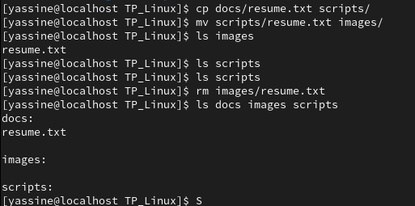

| N° | Question | Réponse |
|---|---|---|
| 12 | Créer notes.txt dans docs et y ajouter le texte | `touch docs/notes.txt` crée le fichier vide, puis `echo "Premier test d'édition sous Linux." >> docs/notes.txt` ajoute la ligne à la fin (`>>` ajoute, `>` écraserait). `ls -l docs` → `notes.txt` fait 36 octets |
| 13 | Afficher notes.txt sans éditeur | `cat docs/notes.txt` → `Premier test d'édition sous Linux.` |

| N° | Question | Réponse |
|---|---|---|
| 14 | Modifier notes.txt avec nano | `nano docs/notes.txt` ouvre l'éditeur dans le terminal ; on modifie le texte, `Ctrl+O` puis Entrée enregistre, `Ctrl+X` quitte. Contenu après modification : `Modifié avec nano` |

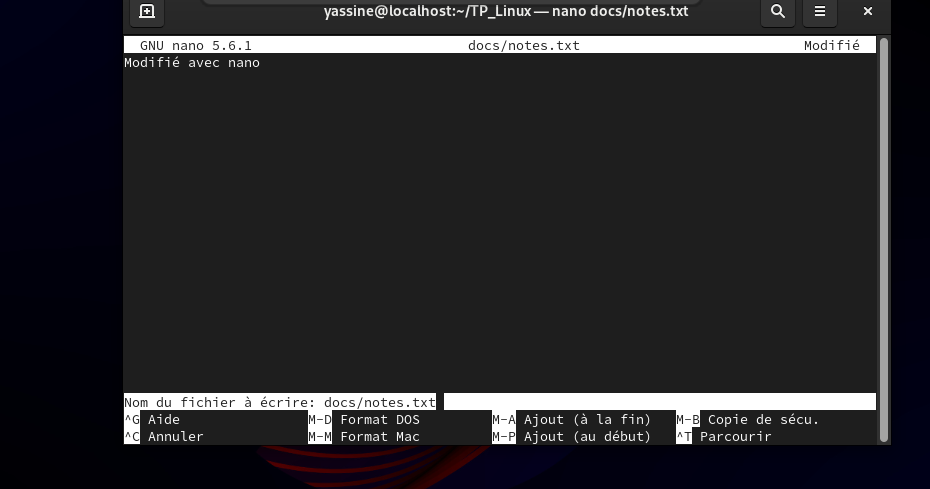

| N° | Question | Réponse |
|---|---|---|
| 15 | Supprimer TP_Linux et son contenu en une commande | `rm -r ~/TP_Linux` : `-r` (récursif) supprime le dossier, ses sous-dossiers et leurs fichiers. Juste avant, `cat` confirme la modification de Q14 (`Modifié avec nano`). Après : `ls -d TP_Linux` → `impossible d'accéder à 'TP_Linux': Aucun fichier ou dossier de ce type` |

## Partie 3 : Découverte du FHS (Filesystem Hierarchy Standard)

| N° | Question | Réponse |
|---|---|---|
| 1 | Chemin absolu de la position actuelle | `pwd` → `/home/yassine` (à l'ouverture d'une session, on est dans son répertoire personnel) |
| 2 | Lister les répertoires de la racine et les compter | `cd /` puis `ls` → 20 entrées. `ls -l / \| grep -c '^d'` → **16 répertoires** ; `ls -l / \| grep -c '^l'` → **4 liens symboliques** (`bin`, `sbin`, `lib`, `lib64`), qui pointent vers `/usr` |

| N° | Question | Réponse |
|---|---|---|
| 3 | Rôle de /bin | Contient les commandes essentielles utilisables par tous les utilisateurs (`ls`, `cp`, `cat`…). Sur RHEL 9, `/bin` est un lien vers `/usr/bin` (`ls -ld /bin` → `/bin -> usr/bin`), qui contient 1514 commandes. Exemple : `file /bin/ls` → `ELF 64-bit LSB pie executable`, un programme compilé |
| 4 | Rôle de /sbin, différence avec /bin | Contient les commandes d'administration système (`fdisk`, `mkfs`, `ip`…), destinées à root. C'est un lien vers `/usr/sbin` (546 commandes). Différence : `/bin` sert à tout le monde, `/sbin` à l'administrateur. Preuve : `fdisk -l` en tant que `yassine` → `impossible d'ouvrir /dev/nvme0n1: Permission non accordée` (il faut `sudo`) |

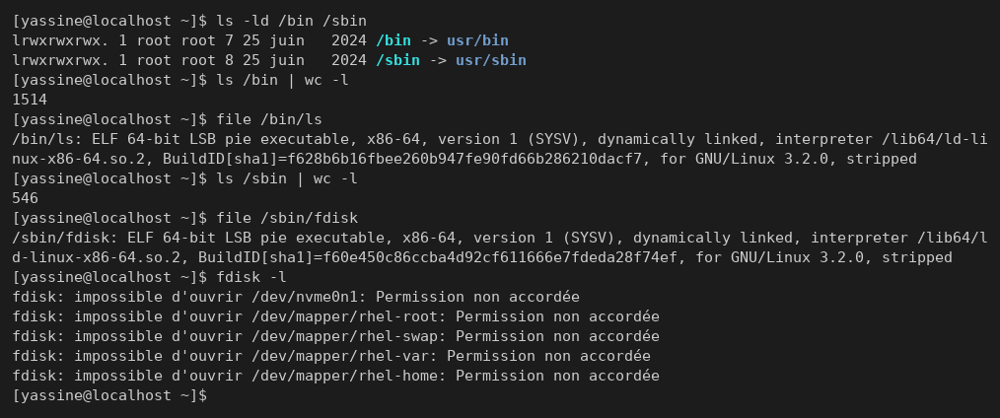

| N° | Question | Réponse |
|---|---|---|
| 5 | Contenu de /etc | Les fichiers de configuration du système et des services (243 entrées). Exemples : `/etc/passwd` (liste des comptes utilisateurs), `/etc/fstab` (systèmes de fichiers montés au démarrage), `/etc/ssh/` (configuration de SSH), `/etc/os-release` → `Red Hat Enterprise Linux 9.8 (Plow)` |
| 6 | Contenu de /home | Les répertoires personnels des utilisateurs : `emsi` et `yassine`. Droits `drwx------` : chaque utilisateur est le seul à accéder à son dossier |
| 7 | Rôle de /root, qui y a accès | C'est le répertoire personnel de l'administrateur root (séparé de `/home`). Droits `dr-xr-x---` (propriétaire root) : seul root y accède. `ls /root` en tant que `yassine` → `Permission non accordée` |

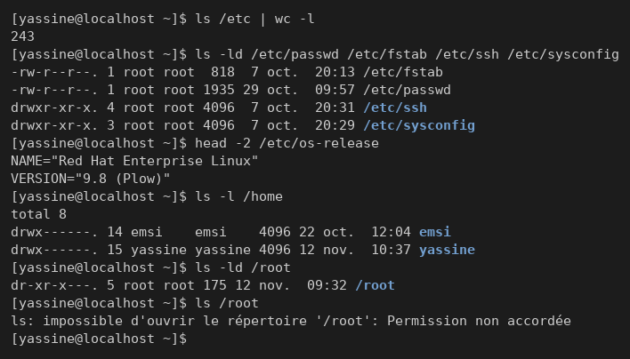

| N° | Question | Réponse |
|---|---|---|
| 8 | Contenu de /var | Les données qui **varient** pendant le fonctionnement : journaux, caches, files d'attente, mails, bases de données. Exemple : `/var/log` contient les journaux (`messages`, `secure` pour les connexions et sudo, `dnf.log` pour les installations, `boot.log`…). Les fichiers datés (`messages-20261112`) sont les anciens journaux archivés par logrotate |
| 9 | Rôle de /tmp, contenu après redémarrage | Fichiers temporaires, accessibles en écriture par tous. Droits `drwxrwxrwt` : le `t` (sticky bit) empêche un utilisateur de supprimer les fichiers des autres. Sur cette VM, `/tmp` n'est **pas** en mémoire (`findmnt /tmp` ne renvoie rien, `tmp.mount` est `disabled`) : il fait partie de la partition `/`, donc **son contenu survit au redémarrage**. C'est `systemd-tmpfiles` qui le nettoie : règle `q /tmp 1777 root root 10d` → suppression des fichiers inutilisés depuis plus de 10 jours (30 jours pour `/var/tmp`) |

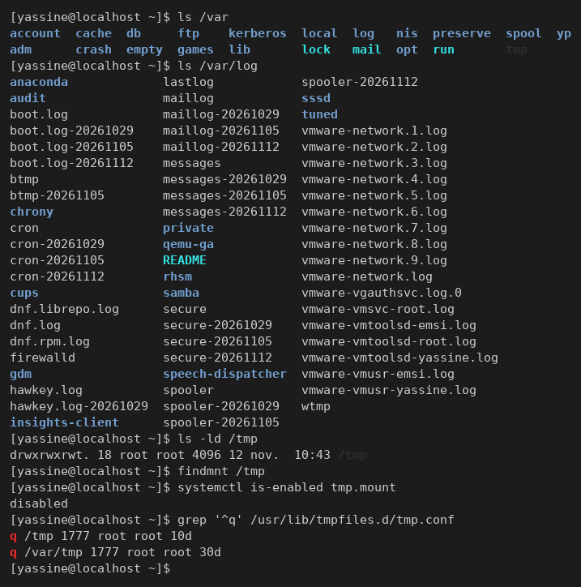

| N° | Question | Réponse |
|---|---|---|
| 10 | Signification et contenu de /usr | *Unix System Resources* : les programmes et données partagés, en lecture seule, installés par les paquets. `ls /usr` → `bin` et `sbin` (commandes), `lib` et `lib64` (bibliothèques), `share` (documentation, pages de manuel, icônes), `include` (en-têtes C), `local` (logiciels installés à la main par l'administrateur), `libexec`, `src` |
| 11 | Rôle de /lib | Les bibliothèques partagées utilisées par les programmes, et les modules du noyau (`/lib/modules`). Sur RHEL 9, `/lib -> usr/lib` et `/lib64 -> usr/lib64` (bibliothèques 64 bits). Exemple : `file /usr/lib64/libc.so.6` → `ELF 64-bit LSB shared object` (bibliothèque C standard) ; `ldd /usr/bin/ls` montre que `ls` utilise `libc.so.6`, `libselinux.so.1`, `libcap.so.2`… |
| 12 | Contenu et rôle de /media | Point de montage prévu pour les **médias amovibles** (clé USB, CD/DVD). Il est vide ici (`ls -la /media` → seulement `.` et `..`), car aucun média n'est branché. Sous RHEL avec GNOME, les médias montés automatiquement apparaissent en pratique dans `/run/media/<utilisateur>/` |
| 13 | Différence entre /mnt et /media | `/media` est pour les montages **automatiques** de médias amovibles ; `/mnt` est pour les montages **manuels et temporaires** faits par l'administrateur (ex. `mount /dev/sdb1 /mnt`). Ici, `/mnt` contient `hgfs`, le point de montage des dossiers partagés VMware |

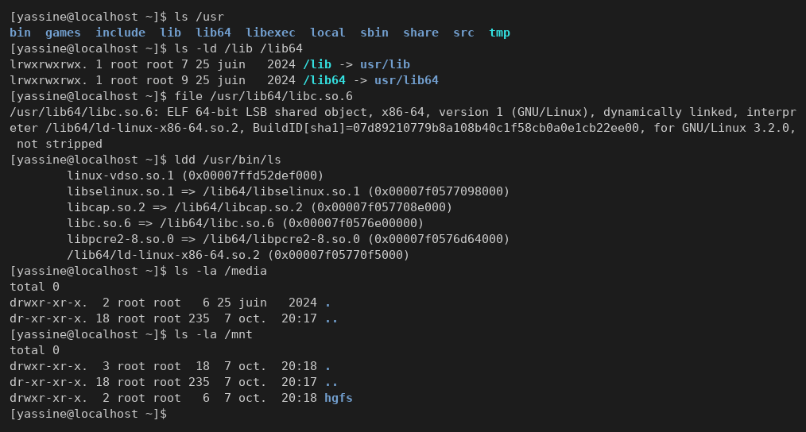

| N° | Question | Réponse |
|---|---|---|
| 14 | Contenu de /dev | Des fichiers spéciaux qui représentent les **périphériques** (172 entrées), créés par le noyau et udev. Le 1er caractère de `ls -l` donne le type : `b` = périphérique bloc (disque `/dev/nvme0n1`, partition `/dev/nvme0n1p1`), `c` = périphérique caractère (`/dev/null`, `/dev/tty`). Les deux nombres (`259, 0`) sont les numéros majeur/mineur utilisés par le noyau. `file /dev/nvme0n1` → `block special`. Le disque de la VM est un NVMe virtuel, d'où `nvme0n1` et non `sda` |
| 15 | Contenu de /proc | Un système de fichiers **virtuel** généré en mémoire par le noyau (rien n'est stocké sur disque). Il y a un dossier par processus en cours (`/proc/<PID>`, 332 ici), ainsi que des fichiers d'information système : `/proc/version` (noyau `5.14.0-687.54.1.el9_8`), `/proc/cpuinfo` (`Intel Core i5-8365U`), `/proc/meminfo` (`MemTotal: 3709408 kB`, soit environ 3,5 Go) |
| 16 | Contenu de /boot, importance au démarrage | Les fichiers nécessaires au démarrage : le noyau `vmlinuz-5.14.0-…`, l'`initramfs` (mini-système chargé en mémoire avec les pilotes nécessaires pour monter `/`), le chargeur GRUB (`grub2/`, entrées dans `loader/`), `config` et `System.map` du noyau, et `efi/` (partition EFI). Sans `/boot`, la machine ne peut pas démarrer. `df -h` → `/boot` sur `/dev/nvme0n1p2` (960 Mo) et `/boot/efi` sur `/dev/nvme0n1p1` (1022 Mo) |

## Partie 4 : Prise en main du terminal et de l'aide en ligne

| N° | Question | Réponse |
|---|---|---|
| 1 | `tty` en console texte (`Ctrl+Alt+F3`) puis dans le terminal graphique | Résultat attendu (à confirmer sur la capture) : en console texte, `tty` affiche `/dev/tty3`, un **terminal virtuel** du noyau, lié à l'écran et au clavier. Dans le terminal graphique, `tty` affiche `/dev/pts/N`, un **pseudo-terminal** créé par l'application Terminal (même chose pour une session SSH). Sur RHEL 9, `Ctrl+Alt+F1` ramène à l'écran de connexion et `Ctrl+Alt+F2` à la session graphique |

| N° | Question | Réponse |
|---|---|---|
| 2 | Utilisateur, shell, répertoire personnel ; signification de `$` et `#` | `whoami` → `yassine` ; `echo $SHELL` → `/bin/bash` ; `echo $HOME` → `/home/yassine`. `id` confirme l'appartenance au groupe `wheel` (droit d'utiliser `sudo`). À la fin de l'invite, `$` indique un **utilisateur normal** et `#` indique **root** (super-utilisateur), par exemple après `sudo -i` |

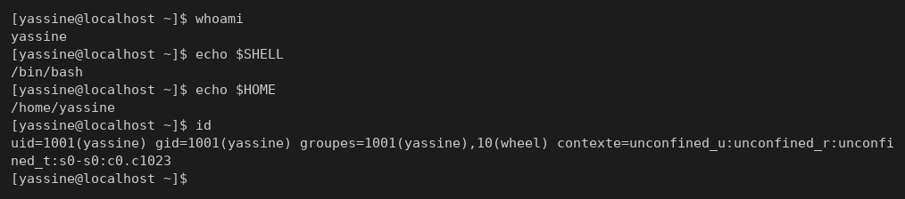

| N° | Question | Réponse |
|---|---|---|
| 3 | Rechercher dans `man ls`, quitter, sections du manuel | Dans `man`, on tape `/mot` puis Entrée pour chercher, `n` pour l'occurrence suivante, `N` pour la précédente, et `q` pour quitter. Les **sections** séparent les pages qui portent le même nom : la section 1 = commandes utilisateur, la section 5 = formats de fichiers de configuration (8 = commandes d'administration). `man 1 passwd` décrit la **commande** `passwd` (*update user's authentication tokens*) ; `man 5 passwd` décrit le **fichier** `/etc/passwd` (*password file*) |
| 4 | `ls --help` contre `man ls` ; `man -k partition` | `ls --help` affiche directement un résumé court, en français (164 lignes) ; `man ls` ouvre la page de manuel complète (245 lignes), en anglais, page par page. `man -k partition` (et `whatis passwd`) → `rien d'adéquat` : l'index des pages de manuel n'est pas encore construit. Il faut d'abord lancer `sudo mandb` (voir la capture ci-dessous) |

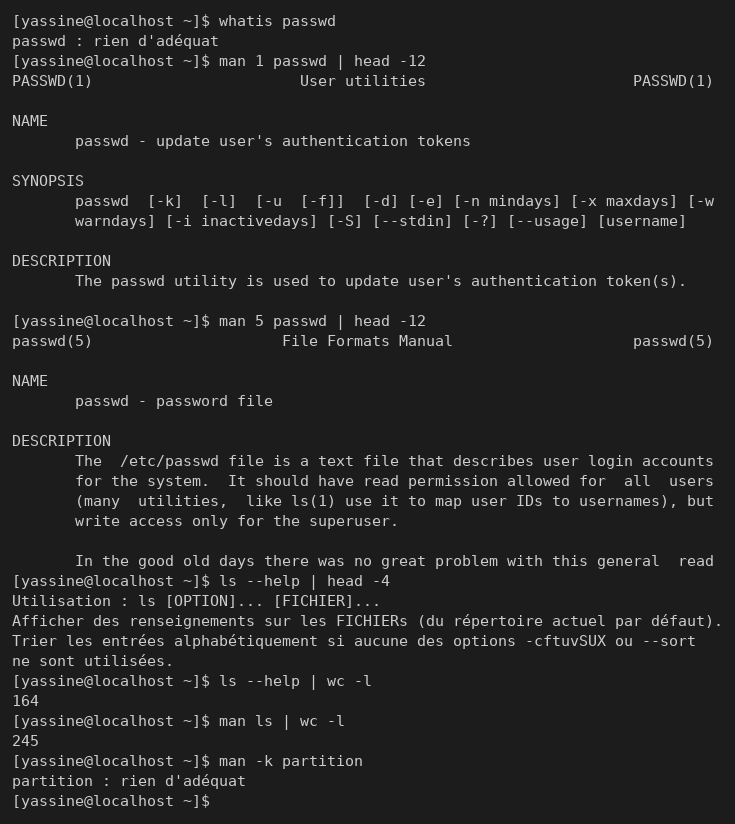

| N° | Question | Réponse |
|---|---|---|
| 5 | `type` et `which` sur cd, ls, pwd ; builtin, alias, exécutable | `type` → `cd` et `pwd` sont des **primitives du shell** (builtin) ; `ls` est un **alias** vers `ls --color=auto`. `which` cherche des **fichiers exécutables** dans le `PATH` → `/usr/bin/ls`, `/usr/bin/cd`, `/usr/bin/pwd` (sur RHEL, `which` est lui-même un alias qui affiche aussi les alias). `type -a pwd` montre les deux : la primitive est prioritaire sur `/usr/bin/pwd`. Différences : une **primitive** est intégrée à bash et s'exécute sans créer de processus (`cd` doit l'être pour changer le dossier du shell lui-même) ; un **alias** est un raccourci texte remplacé avant l'exécution ; un **exécutable** est un fichier du disque lancé dans un nouveau processus |

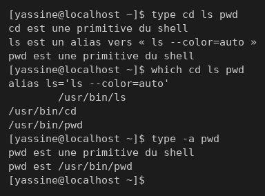

| N° | Question | Réponse |
|---|---|---|
| 6 | Complétion avec Tab | Comportement attendu (à confirmer sur la capture) : `cd /usr/sh` + `Tab` complète en `cd /usr/share/` car il n'y a qu'une seule possibilité. `sys` + `Tab` `Tab` : plusieurs commandes commencent par `sys`, donc le premier `Tab` ne complète rien et le second affiche la liste des possibilités (`sysctl`, `systemctl`, `systemd-…`) |
| 7 | `history`, `!!`, `!n`, `Ctrl+R` | `history` affiche les commandes numérotées ; `!!` relance la dernière commande ; `!n` relance la commande numéro `n` ; `Ctrl+R` lance une recherche inversée : on tape un morceau de commande, bash propose la plus récente qui correspond, Entrée l'exécute |
| 8 | Raccourcis clavier | `Ctrl+C` : interrompt la commande en cours (signal SIGINT) · `Ctrl+L` : efface l'écran (comme `clear`) · `Ctrl+A` : curseur au début de la ligne · `Ctrl+E` : curseur à la fin de la ligne · `Ctrl+U` : efface du curseur jusqu'au début de la ligne · `Ctrl+D` : fin de saisie ; sur une ligne vide, ferme le shell (déconnexion) |

| N° | Question | Réponse |
|---|---|---|
| 9 | Date, calendrier, durée depuis le démarrage | `date` → `jeu. 12 nov. 2026 10:46:17 +00` (la VM est réglée sur le fuseau UTC) ; `cal` → calendrier de novembre 2026, le jour courant (12) en surbrillance ; `uptime` → heure actuelle, `up 1:08` (allumée depuis 1 h 08), `1 user` connecté, et charge moyenne sur 1, 5 et 15 minutes (`0,10, 0,04, 0,01`) |

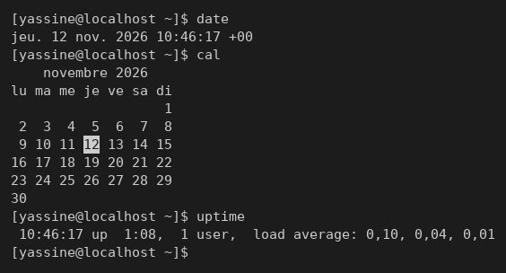

## Partie 5 : Redirections, tubes (pipes) et filtres de texte

Travail dans le dossier `~/TP_Shell` (`mkdir -p ~/TP_Shell` puis `cd ~/TP_Shell`).

| N° | Question | Réponse |
|---|---|---|
| 1 | `>` puis `>>` vers etc.txt, compter les lignes | `ls /etc > etc.txt` crée (ou **écrase**) le fichier → `wc -l etc.txt` → `243`. `ls /var >> etc.txt` **ajoute** à la fin → `264 etc.txt` (243 + 21 entrées de `/var`) |
| 2 | Séparer sortie standard et erreurs ; `&>` ; `2>/dev/null` | `ls /etc /dossier_inexistant > ok.txt 2> erreurs.txt` : `>` redirige la sortie standard (descripteur 1) et `2>` la sortie d'erreur (descripteur 2). `ok.txt` contient 244 lignes (le titre `/etc:` + 243 entrées) ; `erreurs.txt` contient 1 ligne : `ls: impossible d'accéder à '/dossier_inexistant': Aucun fichier ou dossier de ce type`. `&> tout.txt` envoie les deux dans le même fichier (l'erreur apparaît en premier). `2>/dev/null` envoie les erreurs dans `/dev/null`, qui les fait disparaître : seul le résultat utile reste à l'écran |

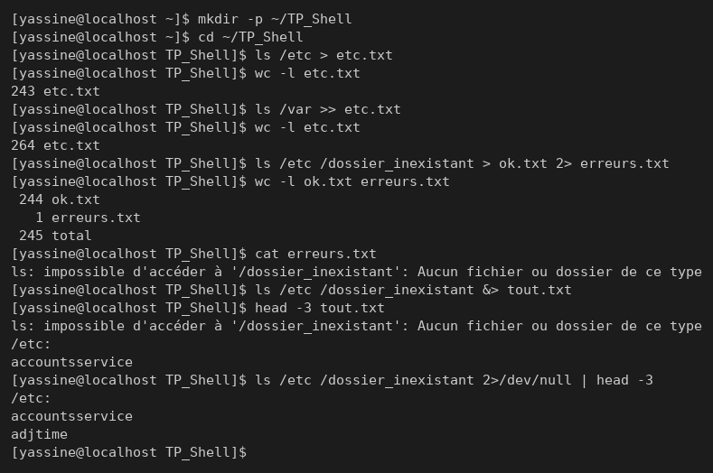

| N° | Question | Réponse |
|---|---|---|
| 3 | 5 premières et 5 dernières lignes de /etc/passwd ; `less` | `head -5 /etc/passwd` → `root`, `bin`, `daemon`, `adm`, `lp` ; `tail -5 /etc/passwd` → `dnsmasq`, `chrony`, `tcpdump`, `emsi`, `yassine` (les derniers comptes créés sont à la fin). `less /etc/services` : `Espace`/`b` pour avancer/reculer d'une page, flèches pour une ligne, `/mot` pour chercher, `n` pour l'occurrence suivante, `q` pour quitter |

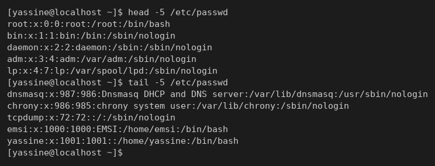

| N° | Question | Réponse |
|---|---|---|
| 4 | `grep` sur son utilisateur ; comptes en /bin/bash | `grep '^yassine:' /etc/passwd` → `yassine:x:1001:1001::/home/yassine:/bin/bash` (`^` = début de ligne : évite d'attraper une autre ligne qui contiendrait « yassine »). `grep -c '/bin/bash$' /etc/passwd` → **3** comptes (`$` = fin de ligne) : `root`, `emsi`, `yassine` |
| 5 | Extraire et trier les noms d'utilisateurs | `cut -d: -f1 /etc/passwd \| sort` : `-d:` choisit `:` comme séparateur, `-f1` garde le 1er champ, `sort` trie par ordre alphabétique → 35 comptes, de `adm` à `yassine` (affichés en colonnes avec `column` pour la capture) |
| 6 | Compter les fichiers `.conf` directement dans /etc | `ls /etc \| grep '\.conf$' \| wc -l` → **34** (`\.` = un vrai point, `$` = fin du nom). Vérification avec `find /etc -maxdepth 1 -type f -name '*.conf' \| wc -l` → **32** vrais fichiers : les 2 autres sont des **liens symboliques** (`nsswitch.conf -> /etc/authselect/nsswitch.conf`, `yum.conf -> dnf/dnf.conf`) |

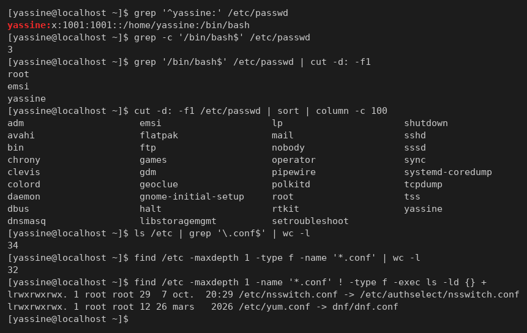

| N° | Question | Réponse |
|---|---|---|
| 7 | `find` par date et par taille | `find /etc -name "*.conf" -mtime -2 2>/dev/null` (`-mtime -2` = modifié il y a moins de 2 jours ; `2>/dev/null` masque les « Permission non accordée » des dossiers réservés à root) → `/etc/resolv.conf` (réécrit par NetworkManager à chaque démarrage), `/etc/modprobe.d/tuned.conf`, `/etc/cups/subscriptions.conf`. `find ~ -type f -size +1M` → 3 fichiers de cache de GNOME (`.cache/mesa_shader_cache/index`, `.cache/gnome-software/...`) |

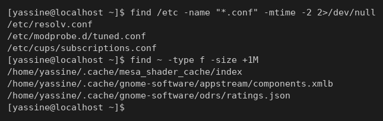

| N° | Question | Réponse |
|---|---|---|
| 8 | `sudo du -sh /var/log/* \| sort -h \| tail -5` | `du -sh` calcule l'espace disque de chaque élément de `/var/log` (`-s` = un total par élément, `-h` = unités lisibles K, M, G) ; `sort -h` trie ces tailles « humaines » de la plus petite à la plus grande ; `tail -5` garde les 5 dernières lignes, donc les 5 plus volumineuses. **Sans `sudo`** (1ère capture), `du` ne peut pas lire plusieurs dossiers (`audit`, `gdm`, `sssd`…) : les erreurs s'affichent et ces dossiers manquent au classement, en tête duquel arrive `anaconda` (8,7M, journaux de l'installation). D'où le besoin de `sudo` (2ème capture) |

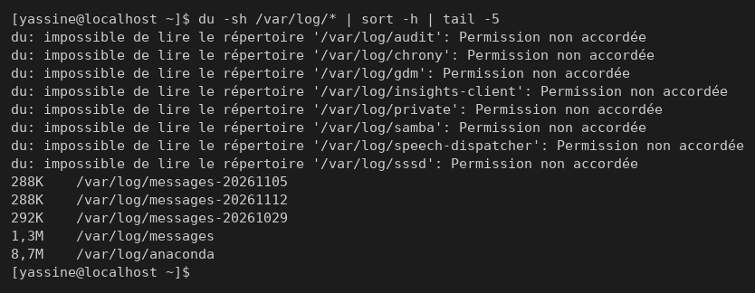

| N° | Question | Réponse |
|---|---|---|
| 9 | `tee` : afficher et enregistrer `ps aux` | `ps aux \| tee processus.txt \| sed -n '1,5p'` : `tee` écrit ce qu'il reçoit **à la fois** dans `processus.txt` et sur sa sortie (l'écran). Ici, l'affichage est limité aux 5 premières lignes avec `sed`, qui lit tout le flux, donc le fichier reste complet. `wc -l processus.txt` → 337 lignes (en-tête + 336 processus) |
| 10 | `ls -l` de /etc/passwd, /etc/shadow et du répertoire personnel | `-rw-r--r--. 1 root root 1935 29 oct. 09:57 /etc/passwd` : `-` = fichier ordinaire ; `rw-` propriétaire (lecture, écriture), `r--` groupe, `r--` autres (644 : tout le monde peut lire la liste des comptes) ; `.` = contexte SELinux présent ; `1` = nombre de liens ; propriétaire `root`, groupe `root` ; taille 1935 octets ; date de dernière modification (création de l'utilisateur `yassine`). `----------. … /etc/shadow` : **aucun droit** (000), seul root peut le lire, car il contient les mots de passe chiffrés. `drwx------. 16 yassine yassine 4096 … /home/yassine` : `d` = répertoire, `rwx------` (700) = seul `yassine` peut lister, créer et entrer ; 16 liens (ses sous-dossiers + `.` + `..`) ; 4096 = taille du bloc de répertoire |

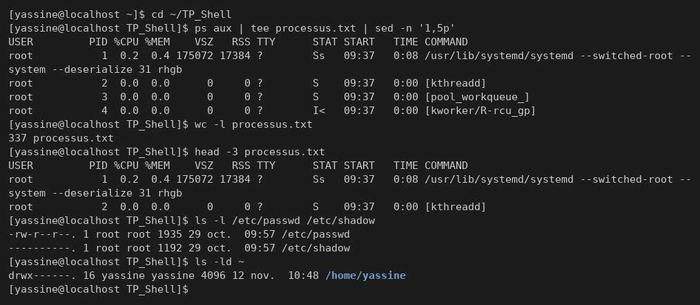

## Partie 6 : Accès distant sécurisé avec SSH

La VM (serveur) est en NAT sur le réseau VMware `VMnet8` (`192.168.197.0/24`) : son adresse est `192.168.197.129`, et l'hôte Windows (poste d'administration) y a l'adresse `192.168.197.1`. Le client est le `ssh` intégré à Windows (PowerShell).

| N° | Question | Réponse |
|---|---|---|
| 1 | sshd actif et lancé au démarrage ; pare-feu | `systemctl status sshd` → `Active: active (running)` depuis le démarrage, `Loaded: … enabled` ; le processus principal `sshd -D [listener]` attend les connexions. Le journal en bas montre les connexions récentes (`Accepted publickey`). `systemctl is-enabled sshd` → `enabled` : le service démarre automatiquement au boot. `sudo firewall-cmd --list-services` liste les services autorisés par le pare-feu ; `ssh` doit y figurer pour que le port TCP 22 soit ouvert (voir la 2ème capture) |

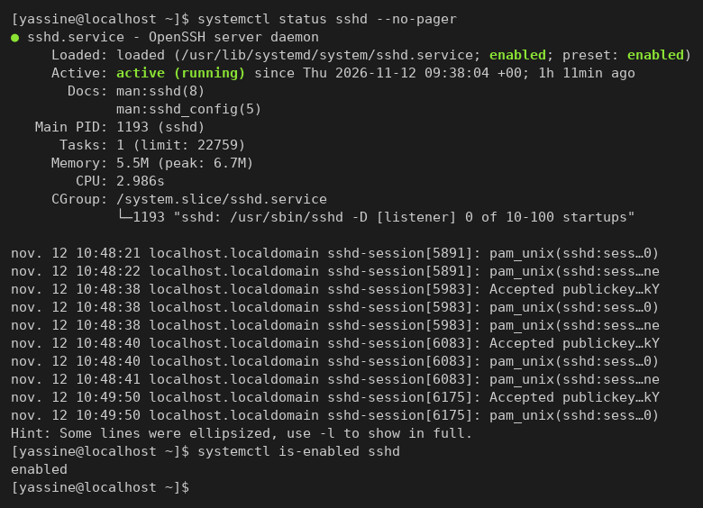

| N° | Question | Réponse |
|---|---|---|
| 2 | Connexion depuis l'hôte | Depuis PowerShell sous Windows : `ssh yassine@192.168.197.129`. À la première connexion, SSH affiche l'empreinte de la clé du serveur (`ED25519 … SHA256:o0GCGADMs2…`) et demande confirmation (`yes`) ; elle est ensuite enregistrée dans `known_hosts`, ce qui permet de détecter un serveur usurpé lors des connexions suivantes. La capture montre aussi l'installation d'une **clé publique** dans `~/.ssh/authorized_keys` : depuis, la connexion se fait par clé, sans mot de passe (`Accepted publickey` dans le journal de sshd) |

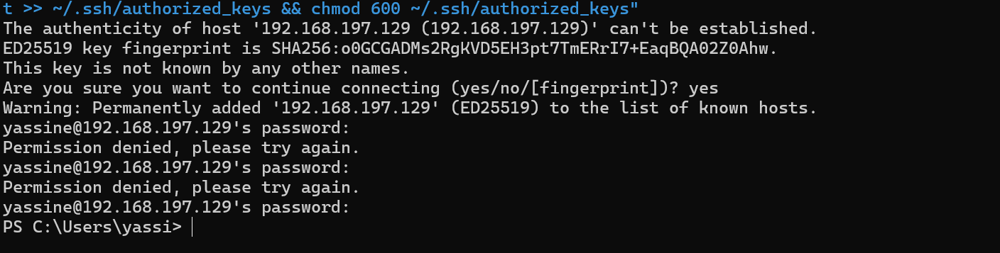

| N° | Question | Réponse |
|---|---|---|
| 3 | Vérifier qu'on est sur le serveur ; `who` et `w` avec deux sessions | `hostname` → `localhost.localdomain` (le nom de la VM, pas celui du PC). `echo $SSH_CONNECTION` → `192.168.197.1 64855 192.168.197.129 22` : IP et port du client, puis IP et port (22) du serveur. Avec deux autres sessions SSH ouvertes, `who` liste 3 connexions : `tty2` (session graphique locale) et `pts/1`, `pts/2` (pseudo-terminaux des sessions SSH, venant de `192.168.197.1`). `w` ajoute la charge, le temps d'inactivité et la commande en cours de chaque session (`gnome-session-binary`, `sleep 60`) |

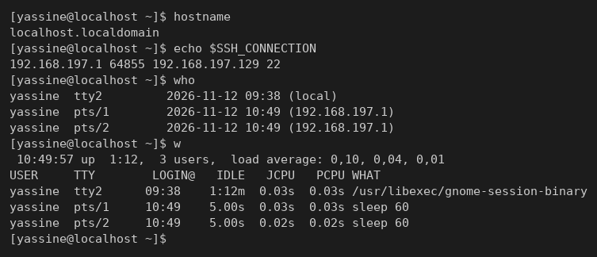

| N° | Question | Réponse |
|---|---|---|
| 4 | Commandes à distance sans session interactive | Depuis l'hôte : `ssh yassine@192.168.197.129 "uptime; df -h /"`. SSH se connecte, exécute les commandes sur le serveur, affiche leur sortie puis se déconnecte aussitôt : l'invite `PS C:\Users\yassi>` revient directement. Résultat : la VM est allumée depuis 1 h 13, et `/` (volume LVM `rhel-root`, 20 Go) est utilisé à 24 %. C'est la base de l'automatisation (scripts, supervision de plusieurs serveurs) |

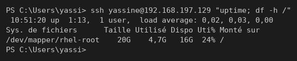
