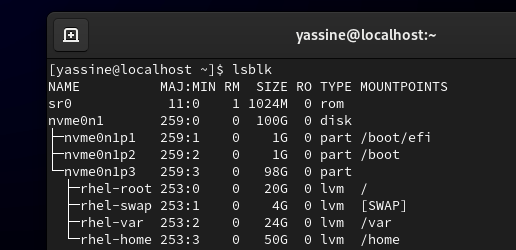
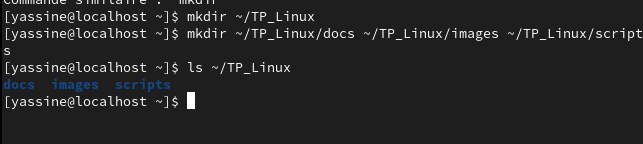
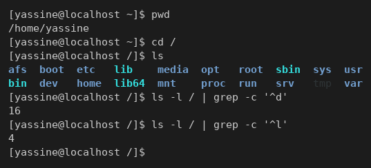
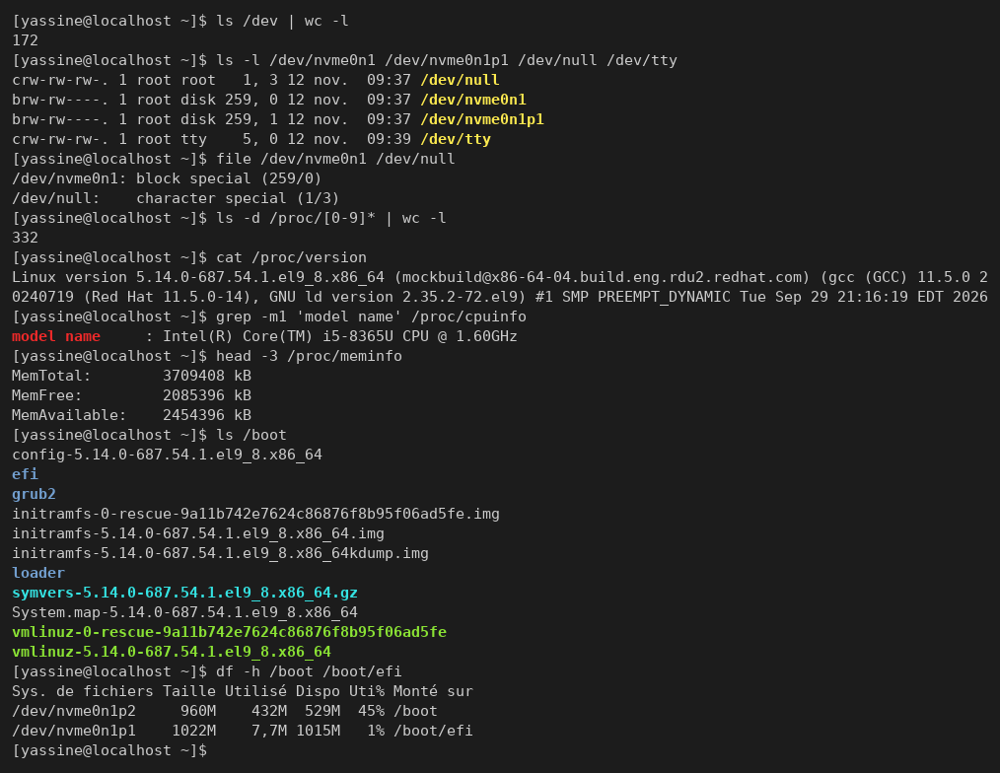

# TP1 — Introduction à l'administration de Linux RHEL 9

**Étudiant :** RHAZI FILALI Mohamed Yassine — 4IIR G4 — 2026/2027

## Partie 1 : Installation de Red Hat Enterprise Linux 9

### Partitionnement (disque de 100 Go)

| Point de montage | Taille | Type |
|---|---|---|
| /boot/efi | 1 Go | partition |
| /boot | 1 Go | partition |
| / | 20 Go | LVM |
| /home | 50 Go | LVM |
| /var | 24 Go | LVM |
| swap | 4 Go | LVM |

Vérification avec `lsblk` :

### Utilisateur administrateur

L'utilisateur `yassine` appartient au groupe `wheel`, ce qui l'autorise à utiliser `sudo`.

### Snapshot « Installation_propre »

## Partie 2 : Commandes de base Linux

> À partir de la question 12, les commandes sont exécutées sur la VM via SSH ; chaque image est le rendu de la sortie brute du terminal.

| N° | Question | Réponse |
|---|---|---|
| 1 | Créer le dossier TP_Linux | `mkdir ~/TP_Linux` |
| 2 | Créer docs, images et scripts | `mkdir ~/TP_Linux/docs ~/TP_Linux/images ~/TP_Linux/scripts` |
| 3 | Afficher le contenu de TP_Linux | `ls ~/TP_Linux` → affiche `docs images scripts` |

| N° | Question | Réponse |
|---|---|---|
| 4 | Aller dans docs (chemin relatif) | `cd TP_Linux/docs` |
| 5 | Créer le fichier vide resume.txt | `touch resume.txt` |
| 6 | Chemin absolu de resume.txt | `realpath resume.txt` → `/home/yassine/TP_Linux/docs/resume.txt` |
| 7 | Revenir au parent et tout afficher | `cd ..` puis `ls -a` → `. .. docs images scripts` |

| N° | Question | Réponse |
|---|---|---|
| 8 | Copier resume.txt de docs vers scripts | `cp docs/resume.txt scripts/` |
| 9 | Déplacer resume.txt de scripts vers images | `mv scripts/resume.txt images/` |
| 10 | Vérifier le déplacement | `ls images` → `resume.txt` (scripts est vide) |
| 11 | Supprimer resume.txt de images | `rm images/resume.txt` |

| N° | Question | Réponse |
|---|---|---|
| 12 | Créer notes.txt dans docs et y ajouter le texte | `touch docs/notes.txt` crée le fichier vide, puis `echo "Premier test d'édition sous Linux." >> docs/notes.txt` ajoute la ligne à la fin (`>>` ajoute, `>` écraserait). `ls -l docs` → `notes.txt` fait 36 octets |
| 13 | Afficher notes.txt sans éditeur | `cat docs/notes.txt` → `Premier test d'édition sous Linux.` |

| N° | Question | Réponse |
|---|---|---|
| 14 | Modifier notes.txt avec nano | `nano docs/notes.txt` ouvre l'éditeur dans le terminal ; on modifie le texte, `Ctrl+O` puis Entrée enregistre, `Ctrl+X` quitte. Contenu après modification : `Modifié avec nano` |

| N° | Question | Réponse |
|---|---|---|
| 15 | Supprimer TP_Linux et son contenu en une commande | `rm -r ~/TP_Linux` : `-r` (récursif) supprime le dossier, ses sous-dossiers et leurs fichiers. Juste avant, `cat` confirme la modification de Q14 (`Modifié avec nano`). Après : `ls -d TP_Linux` → `impossible d'accéder à 'TP_Linux': Aucun fichier ou dossier de ce type` |

## Partie 3 : Découverte du FHS (Filesystem Hierarchy Standard)

| N° | Question | Réponse |
|---|---|---|
| 1 | Chemin absolu de la position actuelle | `pwd` → `/home/yassine` (à l'ouverture d'une session, on est dans son répertoire personnel) |
| 2 | Lister les répertoires de la racine et les compter | `cd /` puis `ls` → 20 entrées. `ls -l / \| grep -c '^d'` → **16 répertoires** ; `ls -l / \| grep -c '^l'` → **4 liens symboliques** (`bin`, `sbin`, `lib`, `lib64`), qui pointent vers `/usr` |

| N° | Question | Réponse |
|---|---|---|
| 3 | Rôle de /bin | Contient les commandes essentielles utilisables par tous les utilisateurs (`ls`, `cp`, `cat`…). Sur RHEL 9, `/bin` est un lien vers `/usr/bin` (`ls -ld /bin` → `/bin -> usr/bin`), qui contient 1514 commandes. Exemple : `file /bin/ls` → `ELF 64-bit LSB pie executable`, un programme compilé |
| 4 | Rôle de /sbin, différence avec /bin | Contient les commandes d'administration système (`fdisk`, `mkfs`, `ip`…), destinées à root. C'est un lien vers `/usr/sbin` (546 commandes). Différence : `/bin` sert à tout le monde, `/sbin` à l'administrateur. Preuve : `fdisk -l` en tant que `yassine` → `impossible d'ouvrir /dev/nvme0n1: Permission non accordée` (il faut `sudo`) |

| N° | Question | Réponse |
|---|---|---|
| 5 | Contenu de /etc | Les fichiers de configuration du système et des services (243 entrées). Exemples : `/etc/passwd` (liste des comptes utilisateurs), `/etc/fstab` (systèmes de fichiers montés au démarrage), `/etc/ssh/` (configuration de SSH), `/etc/os-release` → `Red Hat Enterprise Linux 9.8 (Plow)` |
| 6 | Contenu de /home | Les répertoires personnels des utilisateurs : `emsi` et `yassine`. Droits `drwx------` : chaque utilisateur est le seul à accéder à son dossier |
| 7 | Rôle de /root, qui y a accès | C'est le répertoire personnel de l'administrateur root (séparé de `/home`). Droits `dr-xr-x---` (propriétaire root) : seul root y accède. `ls /root` en tant que `yassine` → `Permission non accordée` |

| N° | Question | Réponse |
|---|---|---|
| 8 | Contenu de /var | Les données qui **varient** pendant le fonctionnement : journaux, caches, files d'attente, mails, bases de données. Exemple : `/var/log` contient les journaux (`messages`, `secure` pour les connexions et sudo, `dnf.log` pour les installations, `boot.log`…). Les fichiers datés (`messages-20261112`) sont les anciens journaux archivés par logrotate |
| 9 | Rôle de /tmp, contenu après redémarrage | Fichiers temporaires, accessibles en écriture par tous. Droits `drwxrwxrwt` : le `t` (sticky bit) empêche un utilisateur de supprimer les fichiers des autres. Sur cette VM, `/tmp` n'est **pas** en mémoire (`findmnt /tmp` ne renvoie rien, `tmp.mount` est `disabled`) : il fait partie de la partition `/`, donc **son contenu survit au redémarrage**. C'est `systemd-tmpfiles` qui le nettoie : règle `q /tmp 1777 root root 10d` → suppression des fichiers inutilisés depuis plus de 10 jours (30 jours pour `/var/tmp`) |

| N° | Question | Réponse |
|---|---|---|
| 10 | Signification et contenu de /usr | *Unix System Resources* : les programmes et données partagés, en lecture seule, installés par les paquets. `ls /usr` → `bin` et `sbin` (commandes), `lib` et `lib64` (bibliothèques), `share` (documentation, pages de manuel, icônes), `include` (en-têtes C), `local` (logiciels installés à la main par l'administrateur), `libexec`, `src` |
| 11 | Rôle de /lib | Les bibliothèques partagées utilisées par les programmes, et les modules du noyau (`/lib/modules`). Sur RHEL 9, `/lib -> usr/lib` et `/lib64 -> usr/lib64` (bibliothèques 64 bits). Exemple : `file /usr/lib64/libc.so.6` → `ELF 64-bit LSB shared object` (bibliothèque C standard) ; `ldd /usr/bin/ls` montre que `ls` utilise `libc.so.6`, `libselinux.so.1`, `libcap.so.2`… |
| 12 | Contenu et rôle de /media | Point de montage prévu pour les **médias amovibles** (clé USB, CD/DVD). Il est vide ici (`ls -la /media` → seulement `.` et `..`), car aucun média n'est branché. Sous RHEL avec GNOME, les médias montés automatiquement apparaissent en pratique dans `/run/media/<utilisateur>/` |
| 13 | Différence entre /mnt et /media | `/media` est pour les montages **automatiques** de médias amovibles ; `/mnt` est pour les montages **manuels et temporaires** faits par l'administrateur (ex. `mount /dev/sdb1 /mnt`). Ici, `/mnt` contient `hgfs`, le point de montage des dossiers partagés VMware |

| N° | Question | Réponse |
|---|---|---|
| 14 | Contenu de /dev | Des fichiers spéciaux qui représentent les **périphériques** (172 entrées), créés par le noyau et udev. Le 1er caractère de `ls -l` donne le type : `b` = périphérique bloc (disque `/dev/nvme0n1`, partition `/dev/nvme0n1p1`), `c` = périphérique caractère (`/dev/null`, `/dev/tty`). Les deux nombres (`259, 0`) sont les numéros majeur/mineur utilisés par le noyau. `file /dev/nvme0n1` → `block special`. Le disque de la VM est un NVMe virtuel, d'où `nvme0n1` et non `sda` |
| 15 | Contenu de /proc | Un système de fichiers **virtuel** généré en mémoire par le noyau (rien n'est stocké sur disque). Il y a un dossier par processus en cours (`/proc/<PID>`, 332 ici), ainsi que des fichiers d'information système : `/proc/version` (noyau `5.14.0-687.54.1.el9_8`), `/proc/cpuinfo` (`Intel Core i5-8365U`), `/proc/meminfo` (`MemTotal: 3709408 kB`, soit environ 3,5 Go) |
| 16 | Contenu de /boot, importance au démarrage | Les fichiers nécessaires au démarrage : le noyau `vmlinuz-5.14.0-…`, l'`initramfs` (mini-système chargé en mémoire avec les pilotes nécessaires pour monter `/`), le chargeur GRUB (`grub2/`, entrées dans `loader/`), `config` et `System.map` du noyau, et `efi/` (partition EFI). Sans `/boot`, la machine ne peut pas démarrer. `df -h` → `/boot` sur `/dev/nvme0n1p2` (960 Mo) et `/boot/efi` sur `/dev/nvme0n1p1` (1022 Mo) |

