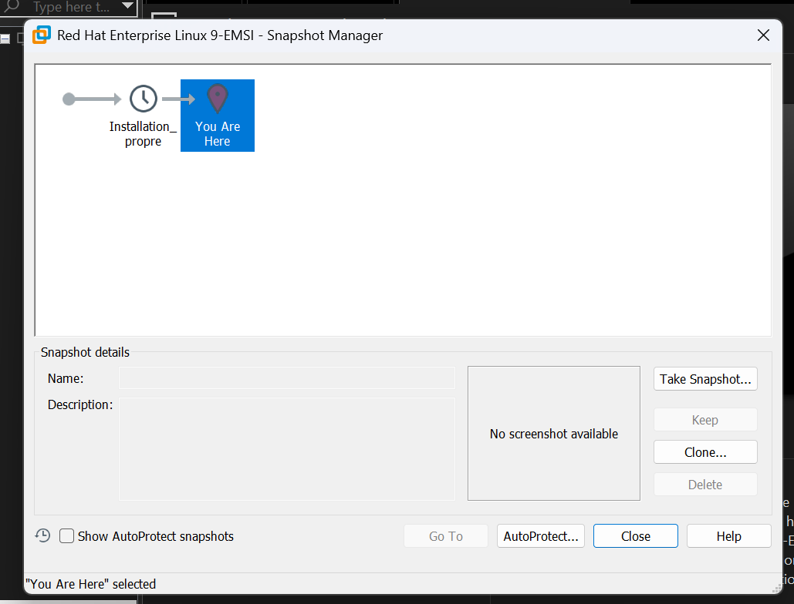
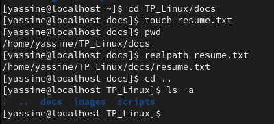
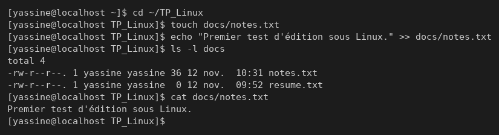
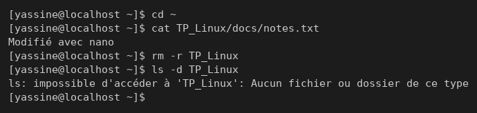

# TP1 — Introduction à l'administration de Linux RHEL 9

**Étudiant :** RHAZI FILALI Mohamed Yassine — 4IIR G4 — 2026/2027

## Partie 1 : Installation de Red Hat Enterprise Linux 9

### Partitionnement (disque de 100 Go)

| Point de montage | Taille | Type |
|---|---|---|
| /boot/efi | 1 Go | partition |
| /boot | 1 Go | partition |
| / | 20 Go | LVM |
| /home | 50 Go | LVM |
| /var | 24 Go | LVM |
| swap | 4 Go | LVM |

Vérification avec `lsblk` :

### Utilisateur administrateur

L'utilisateur `yassine` appartient au groupe `wheel`, ce qui l'autorise à utiliser `sudo`.

### Snapshot « Installation_propre »

## Partie 2 : Commandes de base Linux

> À partir de la question 12, les commandes sont exécutées sur la VM via SSH ; chaque image est le rendu de la sortie brute du terminal.

| N° | Question | Réponse |
|---|---|---|
| 1 | Créer le dossier TP_Linux | `mkdir ~/TP_Linux` |
| 2 | Créer docs, images et scripts | `mkdir ~/TP_Linux/docs ~/TP_Linux/images ~/TP_Linux/scripts` |
| 3 | Afficher le contenu de TP_Linux | `ls ~/TP_Linux` → affiche `docs images scripts` |

| N° | Question | Réponse |
|---|---|---|
| 4 | Aller dans docs (chemin relatif) | `cd TP_Linux/docs` |
| 5 | Créer le fichier vide resume.txt | `touch resume.txt` |
| 6 | Chemin absolu de resume.txt | `realpath resume.txt` → `/home/yassine/TP_Linux/docs/resume.txt` |
| 7 | Revenir au parent et tout afficher | `cd ..` puis `ls -a` → `. .. docs images scripts` |

| N° | Question | Réponse |
|---|---|---|
| 8 | Copier resume.txt de docs vers scripts | `cp docs/resume.txt scripts/` |
| 9 | Déplacer resume.txt de scripts vers images | `mv scripts/resume.txt images/` |
| 10 | Vérifier le déplacement | `ls images` → `resume.txt` (scripts est vide) |
| 11 | Supprimer resume.txt de images | `rm images/resume.txt` |

| N° | Question | Réponse |
|---|---|---|
| 12 | Créer notes.txt dans docs et y ajouter le texte | `touch docs/notes.txt` crée le fichier vide, puis `echo "Premier test d'édition sous Linux." >> docs/notes.txt` ajoute la ligne à la fin (`>>` ajoute, `>` écraserait). `ls -l docs` → `notes.txt` fait 36 octets |
| 13 | Afficher notes.txt sans éditeur | `cat docs/notes.txt` → `Premier test d'édition sous Linux.` |

| N° | Question | Réponse |
|---|---|---|
| 14 | Modifier notes.txt avec nano | `nano docs/notes.txt` ouvre l'éditeur dans le terminal ; on modifie le texte, `Ctrl+O` puis Entrée enregistre, `Ctrl+X` quitte. Contenu après modification : `Modifié avec nano` |

| N° | Question | Réponse |
|---|---|---|
| 15 | Supprimer TP_Linux et son contenu en une commande | `rm -r ~/TP_Linux` : `-r` (récursif) supprime le dossier, ses sous-dossiers et leurs fichiers. Juste avant, `cat` confirme la modification de Q14 (`Modifié avec nano`). Après : `ls -d TP_Linux` → `impossible d'accéder à 'TP_Linux': Aucun fichier ou dossier de ce type` |

