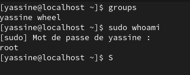

# TP1 — Introduction à l'administration de Linux RHEL 9

**Étudiant :** Yassine Filali — 4IIR — 2026/2027

## Partie 1 : Installation de Red Hat Enterprise Linux 9

### Vérification du partitionnement

### Vérification de l'utilisateur administrateur

### Snapshot « Installation_propre »

